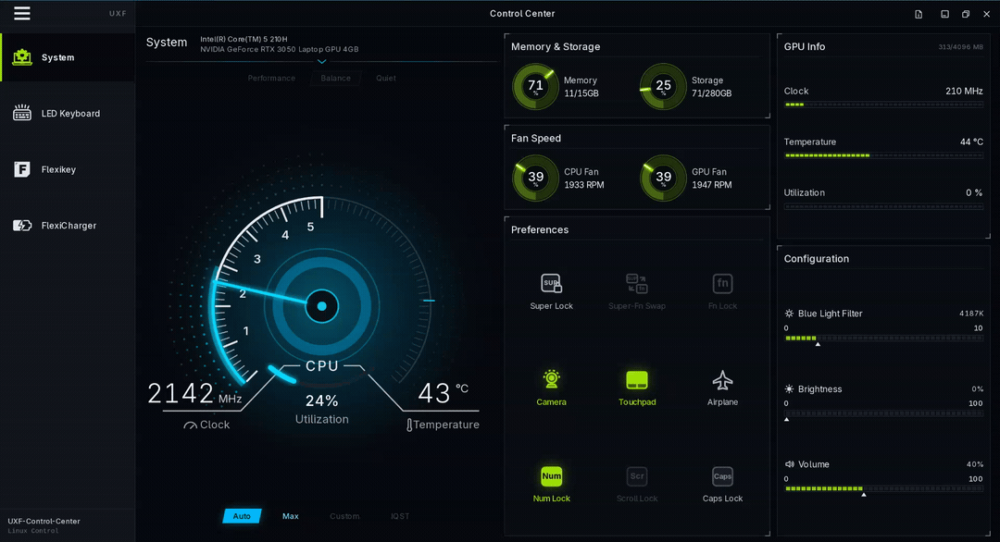
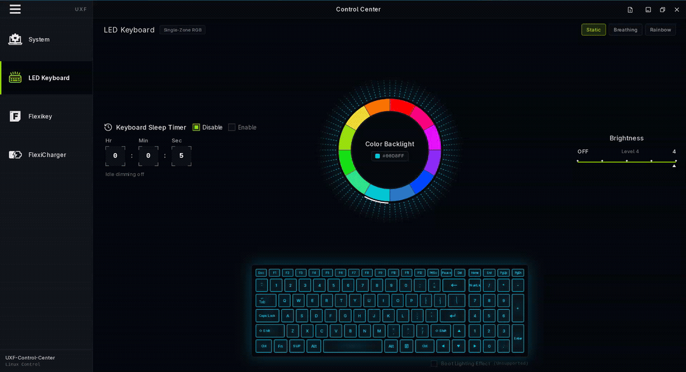
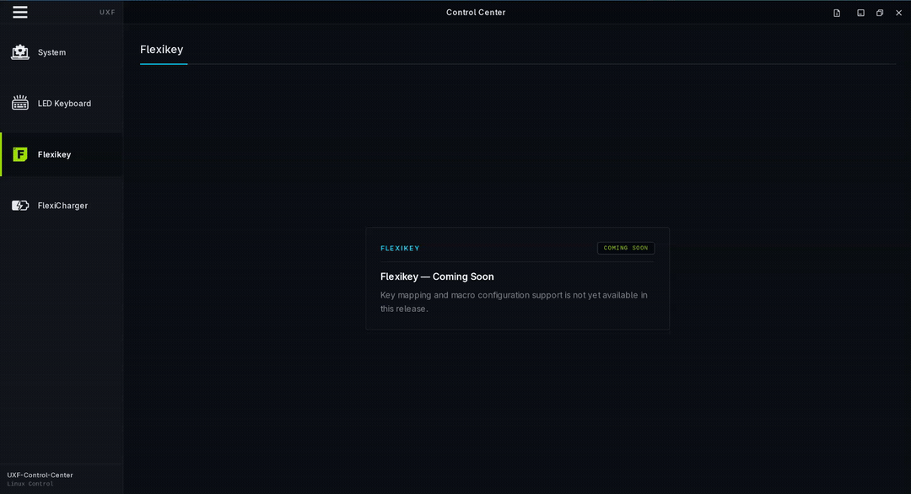
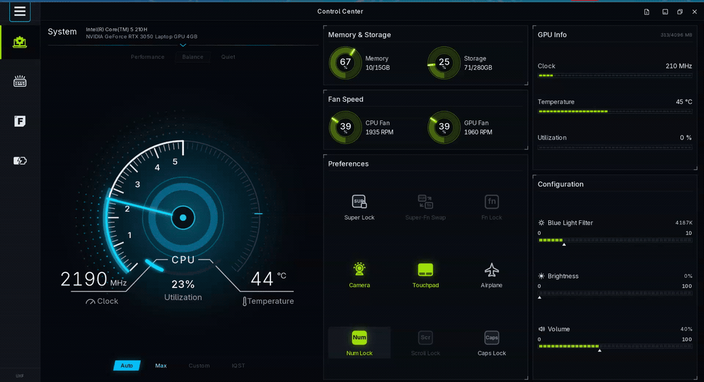

# UXF-Control-Center

[](./LICENSE)
[](https://fedoraproject.org/)
[]()
[](https://github.com/Urxfather/UXF-Control-Center/releases)

**UXF-Control-Center** is an independently maintained, modern Linux control center and DKMS hardware driver suite built specifically for supported Acer gaming laptops. 

It pairs a high-performance desktop interface (**Tauri v2 + React 19**) with a native system daemon (`acer-control-daemon`), low-level character device ioctl drivers (`acer_io`), and ACPI embedded-controller backends (`acer_acpi`) to bring full fan speed controls, thermal monitoring, RGB keyboard lighting effects, and desktop integration to Linux users.

---

## Hardware Compatibility

Different Acer laptop models use varied embedded controllers (EC), ACPI methods, and WMI interfaces. UXF-Control-Center features hardware-aware probing to ensure safe and stable operation.

### Tested & Verified Hardware
* **Acer Aspire 7 A715-79G** (`AlgAl15g53`, Intel Core 5 210H, NVIDIA RTX 3050 / Intel Arc)
  * **Backend:** `acer_acpi` (EC ACPI interface)
  * **Cooling:** Dual-channel fan tachometer telemetry and Auto / Max fan control.
  * **Lighting:** RGB static color, 4 brightness steps, Rainbow cycle, and Breathing mode.
  * **Telemetry:** Real-time CPU/GPU temperatures, live CPU frequencies, memory, and storage metrics.
  * **Desktop Controls:** Display brightness, GNOME Blue Light (Night Light), and system audio volume.

### Recognized Acer Models
Other Acer gaming laptops (such as select Nitro and Predator models) are recognized and supported through dynamic backend selection (`acer_acpi` or fallback `acer_wmi`). Some proprietary features may vary depending on firmware capabilities.

### Untested / Non-Acer Hardware
UXF-Control-Center safely checks DMI identifiers on startup. If an unverified or non-Acer motherboard is detected, the application operates in safe read-only mode to prevent unintended hardware mutations.

> [!NOTE]
> **Flexikey & FlexiCharger:** Key macro binding and battery charge threshold limiters are currently under architectural development and remain in a "Coming Soon" state.

---

## Features

- **Modern Desktop GUI:** Built with Tauri v2, React 19, and Vite for ultra-low memory overhead (~30 MB RAM) and sub-second launch times.
- **Cooling & Fan Controls:** Real-time CPU and GPU tachometers with one-click toggles between Auto and Max speed profiles.
- **RGB Keyboard Lighting:** Full control over static RGB lighting (custom hex/RGB wheel), 4-step backlight brightness, Rainbow gradient animation, and Breathing effects.
- **Hardware Telemetry Dashboard:** Live monitoring of CPU/GPU diode temperatures, clock speeds, system RAM, and swap/storage allocations.
- **Desktop Controls & Preferences:** Integrated screen brightness slider, GNOME Blue Light (Night Light) toggle with color temperature slider, system audio volume, touchpad toggle, camera switch, and lock key indicators.
- **Automated DKMS Driver:** Includes the `acer-keyboard 0.1.1` kernel driver with Linux kernel 7.3+ compatibility, automated multi-kernel builds, and udev permission rules.
- **First-Launch Health Diagnostics:** In-app subsystem diagnostic audit (accessible via the `[i]` icon) scanning hardware DMI, kernel modules, DKMS build status, Secure Boot MOK keys, D-Bus communication, and device permissions.
- **Automated Update Alerts:** Background GitHub Releases checker with in-app notifications and copyable DNF update commands.
- **Fallback Desktop Interface:** The original eframe/egui GUI is retained at `/usr/bin/acer-control-center` as a fallback.

---

## Feature Showcase

Live screen captures recorded directly on an Acer Aspire 7 A715-79G running Fedora Linux.

### 1. System Dashboard & Monitoring
Real-time telemetry showing live CPU frequencies, dial gauge animations, diode temperatures, dual-channel fan tachometers, memory/storage allocation, and desktop controls.



---

### 2. Keyboard LED & RGB Control
Single-zone RGB backlight customization with dynamic 360° color wheel selection, palette presets, 4-step backlight brightness, Rainbow gradient cycle, and Breathing pulse animations.



---

### 3. Upcoming Features
Preview of upcoming architectural modules currently under active development. Flexikey (custom macro and key remapping) and FlexiCharger (battery charge threshold limiter) are not yet available in the current release.



---

### 4. Complete Feature Overview
All-in-one information and diagnostic modal accessible via the navigation header. Includes system identity, live multi-subsystem First-Launch Health Diagnostics (kernel modules, Secure Boot MOK keys, D-Bus daemon, device permissions), and the automated GitHub update checker.



---

## Installation (Fedora 45 / x86_64)

UXF-Control-Center is packaged as a production-grade RPM package that handles dependency resolution, DKMS driver compilation, udev permissions, and systemd service startup automatically.

### 1. Download the Latest RPM
Download `uxf-control-center-2.0.2-3.x86_64.rpm` from [GitHub Releases](https://github.com/Urxfather/UXF-Control-Center/releases).

### 2. Install via DNF
Open a terminal in the folder where the RPM was downloaded and run:

```bash
sudo dnf install ./uxf-control-center-2.0.2-3.x86_64.rpm
```

DNF will automatically resolve and install external dependencies (`dkms`, `kernel-devel-matched`, `libwebkit2gtk-4.1`, etc.), compile the kernel module for your running kernel, configure device permissions, and start the system daemon.

### 3. Launch
Launch **UXF-Control-Center** from your desktop application launcher or run:

```bash
uxf-control-center
```

---

## Architecture

```
┌─────────────────────────────────────────────────────────────┐
│             UXF-Control-Center GUI (Tauri v2 + React 19)   │
│             (/usr/bin/uxf-control-center)                   │
└──────────────────────────────┬──────────────────────────────┘
                               │ D-Bus System Bus
                               ▼
┌─────────────────────────────────────────────────────────────┐
│             acer-control-daemon (Rust System Daemon)        │
│             Endpoint: io.github.stanlysilas.AcerControl     │
└──────────────────────────────┬──────────────────────────────┘
                               │
            ┌──────────────────┴──────────────────┐
            ▼                                     ▼
┌──────────────────────────────┐    ┌─────────────────────────┐
│     acer_acpi / acer_wmi     │    │   acer_keyboard (DKMS)  │
│  (ACPI EC / Thermal IOCTLs)  │    │   (RGB Lighting Kernel) │
└──────────────────────────────┘    └─────────────────────────┘
```

---

## Building from Source

### Prerequisites (Fedora)
```bash
sudo dnf install \
    gcc gcc-c++ make cmake meson ninja-build \
    kernel-devel-matched dkms \
    rust cargo nodejs npm \
    webkit2gtk4.1-devel openssl-devel libappindicator-gtk3-devel
```

### Build Steps

1. **Clone the Repository:**
   ```bash
   git clone https://github.com/Urxfather/UXF-Control-Center.git
   cd UXF-Control-Center
   ```

2. **Build C Driver & Library (`libacercontrol`):**
   ```bash
   meson setup build/meson lib --prefix=/usr --libdir=lib64 --buildtype=release
   meson compile -C build/meson
   ```

3. **Build the System Daemon (`acer-control-daemon`):**
   ```bash
   cargo build --release --manifest-path daemon/Cargo.toml
   ```

4. **Build the Modern GUI (`gui-tauri`):**
   ```bash
   cd gui-tauri
   npm install
   npm run build
   cargo build --release --manifest-path src-tauri/Cargo.toml
   cd ..
   ```

5. **Build RPM Package:**
   ```bash
   LIBDIR=/usr/lib64 packaging/build-package.sh rpm
   ```
   The built RPM package will be located in `dist/uxf-control-center-2.0.2-3.x86_64.rpm`.

---

## Troubleshooting

### Daemon Connection Failed (D-Bus)
Verify that `acer-control-daemon.service` is running:
```bash
systemctl status acer-control-daemon.service
```
Restart the service if needed:
```bash
sudo systemctl restart acer-control-daemon.service
```

### Fan Controls Unavailable (`/dev/acer_io` missing)
Check whether the kernel driver modules are loaded:
```bash
lsmod | grep acer
```
If modules are missing, load them manually:
```bash
sudo modprobe acer_keyboard acer_acpi acer_io
```

### Missing Kernel Headers
If your kernel was recently updated without development headers:
```bash
sudo dnf install kernel-devel-matched
sudo dkms autoinstall
```

---

## AI-Assisted Hardware Compatibility — Adapt UXF-Control-Center for Your Laptop

Because different Acer gaming laptops (Aspire 7, Nitro 5, Nitro 16, Predator Helios, Predator Triton) use different embedded controller (EC) registers, ACPI DCHU device nodes, or WMI GUIDs, you can use modern AI assistants (such as ChatGPT, Gemini, or Claude) to help adapt UXF-Control-Center for your hardware.

### Step 1: Collect Your Laptop's Hardware Diagnostics
Run the following safe, read-only diagnostic commands in your terminal:

```bash
echo "=== DMI System Info ==="
cat /sys/class/dmi/id/sys_vendor
cat /sys/class/dmi/id/product_name
cat /sys/class/dmi/id/board_name

echo "=== Kernel & OS ==="
uname -r
cat /etc/os-release | grep PRETTY_NAME

echo "=== Loaded Acer Modules ==="
lsmod | grep acer

echo "=== ACPI / EC Information ==="
ls -d /sys/devices/platform/acer* 2>/dev/null
ls -d /sys/class/leds/*kbd* 2>/dev/null

echo "=== Character Device Access ==="
ls -l /dev/acer_io 2>/dev/null
```

*(Optional elevated check to see EC memory access response)*:
```bash
sudo dmesg | grep -iE "acer|wmi|dchu"
```

### Step 2: Copy the AI Prompt Template
Copy and paste the template below into your AI coding assistant, attaching your diagnostic output from Step 1:

````markdown
I am running Linux on an Acer laptop and would like to adapt UXF-Control-Center (https://github.com/Urxfather/UXF-Control-Center) for my specific model.

Here are my hardware diagnostic details:
<PASTE YOUR DIAGNOSTIC COMMAND OUTPUT HERE>

Please inspect the UXF-Control-Center architecture:
1. Primary verified reference: Acer Aspire 7 A715-79G (AlgAl15g53) using `acer_acpi` (driver/src/backends/acer/acer_acpi.c) and `acer_io` (driver/src/acer_io/acer_io.c).
2. Daemon D-Bus interface: `io.github.stanlysilas.AcerControl` (daemon/src/backend.rs, daemon/src/dbus.rs).
3. Compare my model's ACPI device paths and DMI identifiers with the existing backends.
4. Identify which features (fan tachometers, fan speed toggles, RGB lighting, thermal diode telemetry) can realistically be supported on my machine.
5. Provide the exact minimal code diff or driver backend adaptations required, ensuring existing A715-79G support is not broken.
6. Outline safe, read-only testing steps to verify before building kernel modules.
````

### Step 3: Contribute Your Findings
AI-assisted modifications must be tested and reviewed before being merged into the official repository. Open an issue or pull request on [GitHub Issues](https://github.com/Urxfather/UXF-Control-Center/issues) sharing your laptop model, diagnostic logs, and proposed diffs so other Linux users with your hardware can benefit.

> [!WARNING]
> - AI assistance does not guarantee hardware compatibility.
> - Never issue unverified low-level EC write commands or blindly flash untested kernel modules.
> - Always maintain a bootable kernel backup when testing custom DKMS builds.

---

## Contributing & Community

Contributions, bug reports, and hardware compatibility reports are welcome!
- **Bug Reports & Feature Requests:** [GitHub Issues](https://github.com/Urxfather/UXF-Control-Center/issues)
- **Pull Requests:** [GitHub Pull Requests](https://github.com/Urxfather/UXF-Control-Center/pulls)

Please review existing issues before submitting duplicate hardware reports.

---

## License & Attribution

UXF-Control-Center is licensed under the [GNU General Public License v3.0 or later (GPL-3.0-or-later)](./LICENSE).

- **Project Maintainer:** Urxfather (`UXF⚡`)
- **Original Upstream Base:** Derived from `acer-control-center` by Stanly Silas and contributors under GPL-3.0-or-later. Original copyright notices and licensing attributions are preserved in respective source headers.
- **Third-Party Libraries:** Lucide icons ([LUCIDE-LICENSE](file:///home/uxf01/Downloads/acer-control-center-source/gui/resources/icons/LUCIDE-LICENSE)), Tauri, React, and related open-source crates and packages.
